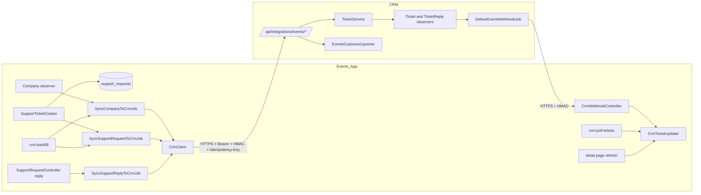

# Design Document

## Overview

This design links the Events_App (this repo) to the CK CRM (`/Applications/XAMPP/xamppfiles/htdocs/CRM_CK/ck-crm`) so support is handled in the CRM's existing ticket system. Both codebases are Laravel (Events_App on `laravel/framework ^13.17`, tests on PHPUnit 12 with Eris for property tests). The two apps share no database. All traffic is HTTPS, token authenticated and HMAC signed.

Flow summary:

- Events to CRM: queued Sync_Jobs call `POST/PATCH /api/integrations/events/*`.
- CRM to Events: signed webhooks to `POST /crm/webhook/tickets`, with a 10 minute Poller as fallback and a stale-on-open refresh.
- The CRM is the source of truth for ticket status and replies once a Support_Request is linked. Events keeps a local copy for display and for outage tolerance.

### Facts found in the existing code that shape the design

| Area | Finding | Consequence |
|---|---|---|
| CRM `customers` | PK `company_id`; columns `company_name`, `customer_name`, `phone_number`, `address_line1/2`, `city`, `state`, `postal_code`, `country`. No email column. | Add `external_ref` and `email` to `customers` (Requirement 2). |
| CRM `tickets` | PK `ticket_id`; `status` validated as `Open, Pending, In Progress, Closed`; `request_category` is a free string (max 100); `ticket_type` is `Incident` or `Service Request`; `priority` is `Low, Normal, High, Critical`. No consent columns. | Add consent and source columns; mapping tables below target these exact values. |
| CRM `TicketService` | `create()`, `update()`, `reply()` shared by admin API and MCP, taking an explicit `$actor` and stamping a `source` column. `reply()` reopens only `Closed`. Customer emails for replies and status changes are sent unconditionally. | Integration reuses `create()` and `reply()`. `reply()` and the email paths need small guarded changes (see CRM changes). |
| CRM MCP | `McpBotUserResolver` creates a non-admin, login-disabled user to attribute writes. | Same pattern reused for the integration identity. |
| CRM API | Admin API is `auth:sanctum` + `EnsureIsAdmin`. MCP group already shows how to order `EnsureHttps`, throttle, auth. | New route group with its own middleware stack. |
| Events hosting | Shared cPanel without `proc_open`. `routes/console.php` uses `Artisan::command(...)` wrapped in `CronRuns::track(...)` and cron invokes artisan directly; the queue is drained by cron `queue:work --stop-when-empty`. | Poller and Backfill_Command are plain Artisan commands, not `Schedule::command`. Webhook delivery and Sync_Jobs must tolerate a cron-drained queue. |
| Events support | `SupportTicketCreator::raise()` persists a `SupportRequest` then emails the inbox. `SupportController` runs outside `dashboard.tenant`, so the `BelongsToCompany` global scope is not active on those routes. | The Support_Portal resolves the Company explicitly and filters by `company_id` itself. |
| Events statuses | `open, in_progress, resolved, closed`; `isClosed()` treats resolved and closed as terminal. | CRM to Events status table below; Requirement 7.5 uses `closed` only. |

## Resolved Design Decisions

### D1. External_Ref column on CRM customers

Migration on the CRM `customers` table:

```php
$table->string('external_ref', 100)->nullable()->unique()->after('company_name');
$table->string('email')->nullable()->index()->after('customer_name');
```

- Value format is `events:{events_company_id}` (for example `events:42`). The namespace prefix keeps the unique index safe if another system is ever linked, while still holding the Events Company identifier (Glossary).
- MySQL permits many NULLs under a unique index, so existing customers are unaffected and need no backfill.
- `email` is new because Requirement 2.3 matches on email and `customers` has none. Email matching checks `customers.email` first, then falls back to the email of any non-admin CRM `users` row in that customer (existing CRM customers hold their email only there). Email matching is case-insensitive on the trimmed value.
- Both columns are added to `Customer::$fillable`.
- Upsert resolution order is fixed: `external_ref`, then email, then create. If an email match already has a different non-null `external_ref`, the CRM does not relink it. It creates a new customer to avoid merging two distinct Events companies that share a contact email.

### D2. Category mapping (Events category to CRM)

The CRM owns this table (Requirement 4.4) in `config/integrations.php` under `events.category_map`. Events sends its machine key. Unknown keys fall back to the `other` row and are logged as a warning.

| Events category | CRM `request_category` | CRM `ticket_type` | CRM `priority` |
|---|---|---|---|
| `account` | Events: Account & Sign-in | Service Request | Normal |
| `events` | Events: Events & Tickets | Service Request | Normal |
| `orders` | Events: Orders, Refunds & Check-in | Service Request | Normal |
| `payments` | Events: Payments & Payouts | Incident | High |
| `billing` | Events: Billing & Fees | Service Request | Normal |
| `technical` | Events: Technical Problem | Incident | Normal |
| `abuse` | Events: Abuse Report | Incident | High |
| `other` | Events: General Enquiry | Service Request | Normal |

All `request_category` values are under 100 characters. The `Events:` prefix lets CRM staff and the portal scorecard group Events work separately. Payments and abuse are raised in priority because they involve money movement and policy risk.

### D3. Status mapping (CRM to Events)

The CRM sends its raw status string. The Events_App maps it with `CrmStatusMapper` (Requirement 5.4). The CRM has no `Resolved` status and this design does not add one, to avoid changing CRM reporting and filters.

| CRM status | Events status | Reasoning |
|---|---|---|
| `Open` | `open` | Direct equivalent. |
| `In Progress` | `in_progress` | Direct equivalent. |
| `Pending` | `resolved` | In the CRM, Pending is "staff have answered, waiting on the customer". Events shows it as resolved-pending-confirmation: replies are still allowed and reopen it (Requirement 7.4). |
| `Closed` | `closed` | Terminal. Replies are rejected in Events (Requirement 7.5). |
| any other value | `open` | Safe fallback, logged as a warning. |

Reverse direction for reopen: a customer reply to a CRM ticket in `Pending` or `Closed` sets it to `Open` and records a `status_changed` TicketActivity. Events_App only polls and webhooks for `open` and `in_progress`; `resolved` tickets still receive webhooks, so a staff reopen or re-close is applied.

Note on `Pending` to `resolved`: this is a judgement call. If CRM staff use Pending for something other than "waiting on customer", change this single row; nothing else depends on it.

### D4. Reply author identity (recommendation: shared integration user plus per-reply author metadata)

Options considered:

1. A CRM `User` per Events user (shadow users). Gives a real `user_id` per author but creates login-capable accounts for people who never signed up to the CRM, duplicates PII, collides with existing CRM users by email, and needs lifecycle sync (rename, delete, GDPR).
2. Match the Events user to an existing CRM user by email. Fails for most Events users, and silently attributes a reply to the wrong person if the email is shared.
3. One dedicated non-admin integration user (`events-integration@system.local`) as `ticket_replies.user_id`, plus metadata columns on the reply carrying the real Customer_Reply_Author. Recommended.

Why option 3:

- It mirrors the proven `McpBotUserResolver` pattern: non-admin, `is_login_disabled = true`, unusable password. It cannot sign in to the CRM or the admin API.
- The same user is the token owner for Integration_Credentials, which gives a cheap check that rejects admin Sanctum tokens (Requirement 1.4).
- Attribution is still exact. Each reply stores `author_name`, `author_email` and `external_user_id` (the Events user id), so staff see "Jane Smith (jane@x.com, Events user 17)" and the reply is traceable even if the Events user is later anonymised.
- No account lifecycle: nothing to create, rename or delete in the CRM when Events users change.
- The integration user's name is never shown to customers: the reply is classed as a customer reply from `source = 'events'`.

CRM schema additions for this:

```php
// ticket_replies
$table->string('author_name', 150)->nullable();
$table->string('author_email')->nullable();
$table->string('external_user_id', 64)->nullable();
// source already exists (admin | mcp); 'events' is added as a value.

// tickets
$table->string('source', 20)->nullable()->index();          // 'events' for integration tickets
$table->string('external_user_id', 64)->nullable();
$table->string('requester_name', 150)->nullable();
$table->string('requester_email')->nullable();
$table->boolean('access_consent')->default(false);
$table->timestamp('access_consent_at')->nullable();
```

Ticket `user_id` is left null for integration tickets; the requester is held in `requester_name` and `requester_email`. The existing `notifyCustomer()` fallback picks "first user of the company", which would be wrong for Events customers, so integration tickets must never use it (see CRM email suppression).

The author type returned to Events is derived, not stored: a reply is `customer` when `source = 'events'`, or when its user is non-admin and not an integration or bot user (CRM portal customers); otherwise `staff`.

## Architecture



## Components and Interfaces

This section covers the CRM app (`ck-crm`) first, then the Events_App.

### CRM changes (`ck-crm`)

### Routes and middleware

New file `routes/integrations_events.php`, loaded from `routes/api.php` (or `bootstrap/app.php` `then:`), prefix `api/integrations/events`. Middleware, outer to inner:

1. `EnsureHttps` (existing).
2. `throttle:events-integration`: named limiter, 120 per minute, keyed on token id or IP (Requirement 1.5).
3. `RestrictEventsIntegrationIp`: allows all when `integrations.events.allowed_ips` is empty, otherwise 403 for addresses outside the list (supports exact IPs and CIDR) (Requirement 1.6).
4. `auth:sanctum`: missing or invalid token gives 401 (Requirement 1.2).
5. `EnsureEventsIntegrationToken`: 403 unless the token's tokenable is the integration user, which rejects every admin token regardless of its abilities (Requirement 1.4). Per-route `ability:` checks then give 403 for missing ability (Requirement 1.3).
6. `VerifyEventsSignature` (write methods only): validates `X-CK-Signature` and `X-CK-Timestamp`, 401 on failure (Requirement 1.8).
7. `EventsIdempotency` (write methods only): see below.

| Method and path | Ability | Purpose |
|---|---|---|
| `POST /customers/upsert` | `events:customers:write` | Upsert by External_Ref, then email, else create. |
| `PATCH /customers/{company_id}` | `events:customers:write` | Partial update. |
| `POST /tickets` | `events:tickets:write` | Create ticket via `TicketService::create`. |
| `GET /tickets/{ticket_id}` | `events:tickets:read` | Ticket status and public replies. |
| `GET /tickets?ids[]=…&since=…` | `events:tickets:read` | Batch fetch for the Poller (max 50 ids). |
| `POST /tickets/{ticket_id}/replies` | `events:tickets:write` | Customer reply. |

Tokens are issued by an Artisan command `integrations:events-token` that creates a Sanctum token on the integration user with exactly these three or four abilities and prints it once. Ticket endpoints scope every lookup to `source = 'events'` and, for writes, to the supplied `company_id`; a mismatch returns 404.

### Signature scheme (both directions)

```
timestamp = unix seconds (header X-CK-Timestamp)
signature = "sha256=" . hash_hmac('sha256', timestamp . '.' . rawBody, secret)   (header X-CK-Signature)
```

Verification uses `hash_equals` and rejects timestamps more than 300 seconds from now. The timestamp stops replay of a captured request. The same scheme signs Events to CRM writes and CRM to Events webhooks, using the single shared secret from Requirement 10.1.

### Idempotency

New table `integration_idempotency_keys`:

| Column | Type |
|---|---|
| `id` | bigint |
| `scope` | string(40), `'events'` |
| `key` | string(120) |
| `request_hash` | char(64), sha256 of method, path, body |
| `response_status` | smallint, nullable until finished |
| `response_body` | json, nullable |
| `created_at` | timestamp |

Unique index on (`scope`, `key`). Middleware flow: insert the row first (unique violation means another request owns the key). If the row is complete and `request_hash` matches, replay the stored status and body with header `Idempotent-Replay: true`. If the hash differs, respond 422. If the row exists but is unfinished (concurrent in flight), respond 409 with `Retry-After: 2`. Only 2xx responses are stored; on 4xx/5xx the row is deleted so the client can retry. A prune command removes rows older than 7 days.

### Customer upsert (`EventsCustomerUpserter`)

Input: `external_id`, `name`, `email`, `phone`, `address_line_1`, `address_line_2`, `city`, `postcode`, `country`.

```php
public function upsert(array $d): array   // ['customer' => Customer, 'action' => 'updated'|'linked'|'created']
{
    $ref = 'events:'.$d['external_id'];

    return DB::transaction(function () use ($d, $ref) {
        if ($c = Customer::where('external_ref', $ref)->lockForUpdate()->first()) {
            return [$this->fill($c, $d), 'updated'];
        }
        if ($c = $this->findByEmail($d['email'])) {
            if ($c->external_ref === null) {
                $c->external_ref = $ref;
                return [$this->fill($c, $d), 'linked'];
            }
        }
        return [$this->fill(new Customer(['external_ref' => $ref]), $d), 'created'];
    });
}
```

A concurrent duplicate create is stopped by the unique index; the loser catches the unique violation and re-reads by `external_ref`. Field mapping Events to CRM: `name` to `company_name`, `phone` to `phone_number`, `address_line_1` to `address_line1`, `address_line_2` to `address_line2`, `postcode` to `postal_code`, `email` to `email`, `city` and `country` as is. On `linked`, existing non-empty CRM values are not blanked by empty Events values. The response is `{ company_id, action }`.

`PATCH` applies only keys present in the request (`array_key_exists`), so absent keys are never touched (Requirement 3.2).

### Ticket creation

`POST /tickets` body: `company_id`, `category`, `subject`, `message`, `access_consent`, `access_consent_at`, `requester: {name, email, external_user_id}`, `notify_customer`, `events_support_request_id`.

The controller maps the category (D2) then calls the existing `TicketService::create()` with the integration user as `$actor`, passing `description = message`, `status = Open` (unchanged), `user_id = null`, and `notifyCustomer = (bool) notify_customer`. A follow-up update sets `source = 'events'`, the requester columns and the consent columns. Because `create()` already sends `NewTicketNotification` to admins and `Ticket::create` runs normal activity paths, staff are alerted as for any ticket (Requirement 4.2). Create and the follow-up update run in one DB transaction. Response: `{ ticket_id, status, created_at }`.

### Reply endpoint

`POST /tickets/{ticket_id}/replies` body: `company_id`, `message` (max 5000), `author: {name, email, external_user_id}`. The controller calls `TicketService::reply($ticket, ['body' => …], $integrationUser, false)`, then sets `source = 'events'` and the three author columns on the new reply. Changes inside `TicketService::reply()`:

- Reopen when status is `Closed` or `Pending` (currently only `Closed`), writing the `status_changed` activity (Requirement 7.4). Behaviour for existing callers stays correct because `Pending` tickets receiving a reply from the admin are already effectively "answered"; to avoid changing admin behaviour, the reopen on `Pending` applies only when `$actor` is the integration user or the reply source is `events`.
- When the reply source is `events`, skip `notifyCustomer()` (a customer should not be emailed their own reply) and notify the assigned staff member or, if unassigned, all admins through the existing `NewTicketNotification` family: a new `CustomerRepliedNotification` using the same channels (Requirement 7.7).

### Email suppression for Events tickets

`TicketService::notifyCustomer`, `notifyCustomerTicketCreated` and `notifyCustomerStatusChange` return early when `$ticket->source === 'events'`. The Events_App sends its own staff-reply email (Requirement 8.10), and without this guard the CRM would email the wrong person via the "first company user" fallback or no one. `notify_customer = false` on create (Requirements 4.9, 9.6) is then redundant for Events tickets but still honoured and kept in the contract.

### Webhook delivery

- `TicketObserver::updated`: when `source = 'events'` and `status` was changed, dispatch `DeliverEventsWebhookJob` with event `ticket.status_changed` (Requirement 8.1).
- `TicketReplyObserver::created`: when the parent ticket is `source = 'events'`, the reply is not internal and `source !== 'events'` (staff reply), dispatch event `ticket.reply_added` (Requirement 8.2). Customer replies from Events are not echoed back.
- The job posts the signed payload below to `integrations.events.webhook_url`. `tries = 5`, `backoff = [30, 120, 600, 1800, 3600]`, 10 second timeout. Treat 2xx and 202 as success; 401 and 5xx retry. After the last attempt, log with ticket id (no secrets).

Webhook payload:

```json
{
  "event_id": "uuid",
  "event": "ticket.status_changed | ticket.reply_added",
  "ticket_id": 1234,
  "status": "In Progress",
  "ticket_updated_at": "2026-01-01T12:00:00Z",
  "reply": {
    "id": 98,
    "author_type": "staff",
    "display_name": "Sam",
    "body": "…",
    "created_at": "2026-01-01T12:00:00Z"
  }
}
```

`reply` is present only for `ticket.reply_added`. The queue on the CRM is drained by the CRM's existing worker or cron.

### Presenters (Internal_Notes and staff privacy)

All Integration_API responses go through `EventsTicketPresenter`, which:

- queries replies with `where('is_internal', false)` at the query level, never filtering afterwards (Requirement 6.2);
- never loads `TicketActivity` or internal fields such as `user_id`, `asset_id`, `due_at`;
- returns reply `display_name` as: for staff, the user's `first_name`, or the configured team label (`integrations.events.staff_team_label`, default "CK Support") when the first name is blank or the user is the MCP bot; for customer replies, `author_name` (Requirement 6.5). Staff email addresses are never serialised.

## Events_App changes (this repo)

### Configuration (`config/services.php`, `.env.example`)

```php
'crm' => [
    'enabled' => (bool) env('CRM_ENABLED', false),
    'base_url' => env('CRM_BASE_URL'),                 // e.g. https://crm.example.com
    'token' => env('CRM_API_TOKEN'),
    'webhook_secret' => env('CRM_WEBHOOK_SECRET'),
    'timeout' => (int) env('CRM_TIMEOUT', 8),
],
```

`.env.example` gains `CRM_ENABLED=false`, `CRM_BASE_URL=`, `CRM_API_TOKEN=`, `CRM_WEBHOOK_SECRET=`, `CRM_TIMEOUT=8` with comments and no values (Requirement 10.2).

## Data Models

CRM schema additions are in D1 and D4 plus the `integration_idempotency_keys` table described under Idempotency. Events_App migrations:

```php
// companies
$table->unsignedBigInteger('crm_customer_id')->nullable()->index();

// support_requests
$table->unsignedBigInteger('crm_ticket_id')->nullable()->unique();
$table->string('crm_status', 40)->nullable();          // last raw CRM status
$table->timestamp('crm_synced_at')->nullable();
$table->timestamp('crm_updated_at')->nullable();       // CRM ticket_updated_at last applied
$table->string('crm_sync_state', 20)->default('pending'); // pending | synced | failed

// support_request_replies (new)
$table->id();
$table->foreignId('support_request_id')->constrained()->cascadeOnDelete();
$table->foreignId('company_id')->constrained();        // tenant scoping and isolation checks
$table->foreignId('user_id')->nullable()->constrained()->nullOnDelete();
$table->unsignedBigInteger('crm_reply_id')->nullable()->unique();
$table->string('author_type', 10);                     // staff | customer
$table->string('author_name', 150);
$table->text('body');
$table->string('sync_state', 20)->default('synced');   // pending | synced | failed (customer replies)
$table->string('sync_error', 255)->nullable();
$table->timestamp('posted_at');                        // CRM created_at for staff, local for customer
$table->timestamps();
$table->index(['support_request_id', 'posted_at']);
```

New model `SupportRequestReply` (`BelongsToCompany`). Internal_Notes have no column or code path to be stored (Requirement 6.3); the client drops any payload reply flagged internal as defence in depth.

### Components

| Component | Responsibility |
|---|---|
| `App\Services\Crm\CrmClient` | Single HTTP gateway. Builds `Http::baseUrl()->timeout(min(config, 10))->withToken()`, signs bodies, adds `Idempotency-Key` to writes, refuses when disabled or when production uses a non-HTTPS URL, redacts secrets from logged and thrown messages. Methods: `upsertCustomer`, `patchCustomer`, `createTicket`, `getTicket`, `getTickets`, `postReply`. |
| `App\Services\Crm\CrmStatusMapper` | CRM status to Events status (D3). |
| `App\Services\Crm\CrmTicketUpdater` | `apply(SupportRequest, array $ticketPayload)`: the single code path for webhook, Poller and refresh-on-open. |
| `App\Services\Crm\CrmSignature` | `sign(string $body, int $ts, string $secret)` and `verify(...)`. |
| `App\Jobs\SyncCompanyToCrmJob` | Upsert or patch customer; stores `crm_customer_id`. |
| `App\Jobs\SyncSupportRequestToCrmJob` | Ensures customer exists, creates ticket, stores `crm_ticket_id`, `crm_synced_at`, `crm_sync_state`. |
| `App\Jobs\SyncSupportReplyToCrmJob` | Ensures ticket exists, posts reply, sets `sync_state`. |
| `App\Observers\CompanyObserver` | `created` dispatches upsert; `updated` dispatches patch only when `wasChanged(['name','email','phone','address_line_1','address_line_2','city','postcode','country'])`. |
| `App\Http\Controllers\CrmWebhookController` | `POST /crm/webhook/tickets`. |
| `App\Http\Middleware\VerifyCrmSignature` | Applied to the webhook route; 401 on failure. |
| `App\Http\Controllers\SupportRequestController` | `index`, `show`, `reply` for the Support_Portal. |
| `App\Mail\SupportReplyReceivedMail` | Staff reply notification to the submitting user. |
| `crm:poll-tickets`, `crm:backfill` | Artisan commands in `routes/console.php`, wrapped in `CronRuns::track`. |

### Sync jobs

All jobs: `ShouldQueue`, `tries = 5`, `backoff = [30, 120, 600, 1800, 3600]`, `failed()` logging the entity id and a redacted message (Requirement 2.7, 2.8). Each job first checks `CrmClient::isEnabled()` and returns when false (Requirement 10.3). A job that depends on a prior step (ticket needs customer, reply needs ticket) performs that step inline via the same service rather than waiting for another job.

Idempotency-Key values are deterministic so retries and Backfill reruns collapse:

| Call | Key |
|---|---|
| Customer upsert | `customer-upsert:{company_id}` |
| Customer patch | `customer-patch:{company_id}:{sha1(sorted changed payload)}` |
| Ticket create | `ticket-create:{support_request_id}` |
| Reply post | `reply-post:{support_request_reply_id}` |

Signup and the support form never wait on the CRM: `Company::created` and `SupportTicketCreator::raise` only dispatch (using `dispatch()->afterCommit()`), and the confirmation flash in `SupportController::store` is unchanged (Requirement 4.7). `SupportTicketCreator::raise` gets one added line after persisting and before emailing: `SyncSupportRequestToCrmJob::dispatch($ticket->id)->afterCommit();`. Interactive creates send `notify_customer = false`.

### Support_Portal

Routes (inside the same auth group as `support.create`, `->withoutMiddleware('dashboard.tenant')`):

```php
Route::get('/support/requests', [SupportRequestController::class, 'index'])->name('support.requests.index');
Route::get('/support/requests/{id}', [SupportRequestController::class, 'show'])->whereNumber('id')->name('support.requests.show');
Route::post('/support/requests/{id}/replies', [SupportRequestController::class, 'reply'])->whereNumber('id')->name('support.requests.reply');
```

- Because the tenant scope is not active here, the controller resolves the acting Company with the same helper `SupportController` uses, then always queries `SupportRequest::withoutGlobalScopes()->where('company_id', $company->id)`. A request for another Company's id finds no row and returns 404 (Requirements 5.2, 5.3). The same filter applies on `reply`.
- `index` paginates 20 (Requirement 5.6) ordered by `updated_at desc`, showing subject, category label, status label, last updated. A request without `crm_ticket_id` while integration is enabled shows status `open` with a "sending" indicator (Requirement 5.5).
- `show` renders the original message, current status, and `support_request_replies` ordered by `posted_at asc, id asc`, each with author type, name and time (Requirements 6.1, 6.4). If the request is `open` or `in_progress`, linked, and `crm_synced_at` is older than 5 minutes, it first calls `CrmTicketUpdater` with a fresh `getTicket`, using a 5 second timeout and swallowing failures so the page always renders (Requirement 8.9). Failed customer replies show a "could not be sent" marker with the stored `sync_error` (Requirement 7.6).
- `reply` validates `['message' => ['required', 'string', 'max:5000']]` and rejects with a flash message when `status === 'closed'` (Requirement 7.5). Otherwise it stores a `SupportRequestReply` (`author_type = customer`, `sync_state = pending`) and dispatches `SyncSupportReplyToCrmJob`. Validation of whitespace-only input uses `trim` via Laravel's `TrimStrings` and `required`.

### Applying CRM updates (`CrmTicketUpdater`)

Input is a ticket payload in the shape shared by webhook and API responses (`ticket_id`, `status`, `ticket_updated_at`, `replies[]` or single `reply`). Rules:

1. Find the `SupportRequest` by `crm_ticket_id`; absent means no-op.
2. Skip entirely if `ticket_updated_at` is older than `crm_updated_at` (out-of-order delivery). Otherwise map the status (D3), set `status`, `crm_status`, `crm_updated_at`, `crm_synced_at`, and `resolved_at` when the mapped status becomes `resolved` or `closed`.
3. For each reply, drop it if flagged internal; otherwise `firstOrCreate` on `crm_reply_id`. Duplicates cannot occur because of the unique index.
4. For each newly created staff reply, send `SupportReplyReceivedMail` to the submitting user (Requirement 8.10). A reply that already existed sends nothing, so repeated webhooks or polls do not re-email.
5. All of the above run in one DB transaction.

Because webhook, Poller and refresh all call this method, they behave identically (Requirement 8.7).

### Webhook receiver

```php
public function handle(Request $request): JsonResponse
{
    // VerifyCrmSignature middleware has already returned 401 for bad signatures
    $sr = SupportRequest::withoutGlobalScopes()->where('crm_ticket_id', $request->integer('ticket_id'))->first();
    if (! $sr) {
        return response()->json(['status' => 'ignored'], 202);   // Requirement 8.5
    }
    $this->updater->apply($sr, $request->all());
    return response()->json(['status' => 'ok']);
}
```

The route sits outside CSRF, auth and tenant middleware, like the Stripe webhook (`/stripe/webhook`), with a `throttle` limiter. `VerifyCrmSignature` requires the raw body, uses `hash_equals`, a 300 second timestamp window, and returns 401 with no data change on any failure (Requirement 8.4).

### Poller (`crm:poll-tickets`)

Runs through cron directly (`php artisan crm:poll-tickets` every 10 minutes), wrapped in `CronRuns::track('crm:poll-tickets', …)`. It selects `SupportRequest` rows with `status in (open, in_progress)` and a non-null `crm_ticket_id`, chunks ids by 50, calls `getTickets(ids)`, and applies each result through `CrmTicketUpdater`. A chunk failure is logged and does not stop the other chunks. It no-ops when the integration is disabled.

### Backfill (`crm:backfill {--dry-run}`)

1. Select `Company` rows where `crm_customer_id` is null (excluding rows with no email, counted as skipped).
2. Select `SupportRequest` rows where `crm_ticket_id` is null.
3. With `--dry-run`: print what would sync and send no HTTP requests (checked by `CrmClient` not being called).
4. Otherwise run the same Sync logic synchronously, in company-then-ticket order, passing `notify_customer = false` for every ticket (Requirement 9.6). Deterministic Idempotency-Keys make reruns safe, and the `whereNull` selectors skip already-linked rows (Requirement 9.3).
5. Print counts: synced, skipped, failed (Requirement 9.5). Exit code is non-zero if any failed.

## Error Handling

| Situation | Behaviour |
|---|---|
| Integration disabled | `CrmClient` throws `CrmDisabledException`; jobs treat it as a clean skip; data stays local (10.3). |
| Non-HTTPS URL in production | `CrmClient` logs a configuration error and refuses to send (10.7). |
| Network error, timeout, 5xx, 429 | Job retries with backoff up to 5 attempts; `failed()` logs id and redacted error (2.7, 2.8). Request still stored and shown. |
| 4xx validation (422) on ticket create | No retry (`fail()` immediately); `crm_sync_state = failed`. |
| 422 on reply | Reply `sync_state = failed`, `sync_error` stored, no retry (7.6). |
| 404 on reply or ticket fetch | Logged; `crm_sync_state = failed` for the request. |
| 401 or 403 from CRM | Retried (credential rotation windows) and logged as a configuration error. |
| Webhook with bad signature | 401, no change. Unknown ticket: 202, no change. |
| Log and exception content | Passed through `CrmClient::redact()`, which replaces the token and webhook secret and strips `Authorization` header values. |

## Testing Strategy

Dual approach. Eris property tests live in `tests/PBT` (this repo has `giorgiosironi/eris`) with at least 100 iterations each, tagged `Feature: crm-support-integration, Property N: …`. The CRM repo gets its own tests under `tests/Feature/Integrations/Events` and, for the pure parts, property tests if Eris is added there (needs approval to add a dev dependency; otherwise use PHPUnit data providers with generated cases).

Unit and feature tests (`Http::fake()` only, no network):

- Events_App: customer sync on signup and on profile change; ticket creation payload (customer id, category, subject, message, consent, requester); `raise()` still confirms when CRM is down; list and detail isolation; reply submit, closed rejection, failed reply marker; webhook valid, invalid signature, unknown ticket; poller applying updates; backfill including `--dry-run` and rerun; config disabled skips all calls; HTTPS production guard.
- CRM: 401 without token; 403 with wrong ability; 403 with an admin Sanctum token; 429 after 120 requests; IP allow list; idempotent replay returning the same response; signature failure; internal notes absent from every response; upsert precedence by external_ref, then email, otherwise create; ticket created through `TicketService` (admin notification sent, `notify_customer = false` sends no mail); customer reply reopens `Pending` and `Closed` tickets and notifies staff; staff reply and status change dispatch webhooks; webhook retry config.

PBT is not used for the HTTP wiring, middleware stacks, mail, migrations or UI rendering.

## Correctness Properties

*A property is a characteristic or behavior that should hold true across all valid executions of a system-essentially, a formal statement about what the system should do. Properties serve as the bridge between human-readable specifications and machine-verifiable correctness guarantees.*

### Property 1: Signature round trip and tamper rejection

For any request body, timestamp and secret, a signature produced by `CrmSignature::sign` verifies successfully against the same body, timestamp and secret. For any single-byte change to the body, timestamp, or secret, or any timestamp outside the 300 second window, verification fails and no data is changed.

**Validates: Requirements 1.8, 8.4**

### Property 2: Idempotent writes

For any valid write request and any number of repeated deliveries with the same Idempotency_Key, exactly one record is created, and every delivery after the first returns the status and body of the first.

**Validates: Requirements 1.7, 9.3**

### Property 3: IP allow list

For any allow list and any client address, the request is permitted if and only if the list is empty or the address matches an entry (exact or CIDR); otherwise the response is 403.

**Validates: Requirements 1.6**

### Property 4: Customer upsert resolution

For any existing set of CRM customers and any upsert payload, the resolved customer is the one with matching `external_ref` if it exists; otherwise the one with a case-insensitively matching email whose `external_ref` is null (which gets linked); otherwise a newly created customer. A match never produces a new record, and applying the same upsert twice yields the same `company_id` and customer count as applying it once.

**Validates: Requirements 2.2, 2.3, 2.4, 11.5**

### Property 5: Sync dispatch only for synced fields

For any set of changed Company attributes, a customer Sync_Job is dispatched if and only if the set intersects `{name, email, phone, address_line_1, address_line_2, city, postcode, country}`.

**Validates: Requirements 3.1, 3.5**

### Property 6: Partial customer patch

For any existing CRM customer and any subset of patchable fields supplied in a patch, the supplied fields take the new values and every unsupplied field is unchanged.

**Validates: Requirements 3.2**

### Property 7: Category mapping is total

For any Events category key, the CRM mapping returns a non-empty `request_category` of at most 100 characters, a valid `ticket_type` and a valid `priority`; each of the eight defined keys maps to its documented row and any other key maps to the `other` row.

**Validates: Requirements 4.4**

### Property 8: Status mapping is total

For any CRM status string, `CrmStatusMapper` returns exactly one of `open`, `in_progress`, `resolved`, `closed`, and each defined CRM status maps to its documented value.

**Validates: Requirements 5.4**

### Property 9: Company isolation

For any set of Companies and Support_Requests and any acting user, the Support_Portal list contains exactly the requests whose `company_id` equals the user's Company, and a detail or reply request for any request from another Company returns 404 and changes nothing.

**Validates: Requirements 5.1, 5.2, 5.3, 11.3**

### Property 10: Internal notes never cross the boundary

For any ticket with any mix of internal and public replies, no Integration_API response contains an internal reply, and for any webhook or poll payload the Events_App stores no reply flagged internal.

**Validates: Requirements 6.2, 6.3**

### Property 11: Reply presentation

For any set of public replies, the presented list is ordered by creation time ascending; each item carries author type, display name and timestamp; and for any staff user the display name is the first name (or the team label when blank) and the serialised reply contains no staff email address.

**Validates: Requirements 6.1, 6.4, 6.5**

### Property 12: Reply message validation

For any string, a reply is accepted if and only if it contains at least one non-whitespace character and is at most 5000 characters long.

**Validates: Requirements 7.1**

### Property 13: Customer reply attribution and reopen

For any CRM ticket status and any valid customer reply, the created reply is public, carries the supplied author name, email and Events user id, and the ticket status afterwards is `Open` if it was `Pending` or `Closed`, and unchanged otherwise.

**Validates: Requirements 7.3, 7.4**

### Property 14: CRM update application is idempotent and source independent

For any ticket payload, applying it to a Support_Request any number of times yields the same stored status and the same set of replies as applying it once, with no duplicate `crm_reply_id`, and applying it via webhook, Poller or detail-page refresh yields the same resulting state. An older `ticket_updated_at` never overwrites a newer stored status.

**Validates: Requirements 8.3, 8.7**

### Property 15: Backfill is idempotent

For any set of Companies and Support_Requests, running the Backfill_Command twice results in the same CRM customers and tickets as running it once, with the second run reporting zero synced records.

**Validates: Requirements 9.1, 9.2, 9.3**

### Property 16: Effective timeout bound

For any configured timeout value, the timeout applied to a CRM request is at most 10 seconds.

**Validates: Requirements 10.4**

### Property 17: Secrets never leak

For any message containing the Integration_Credential or webhook secret, the redacted text written to logs or exceptions contains neither value.

**Validates: Requirements 10.6**

### Property 18: HTTPS required in production

For any CRM base URL in the production environment, the client sends requests if and only if the URL scheme is `https`; in other environments the scheme does not block sending.

**Validates: Requirements 10.7**
