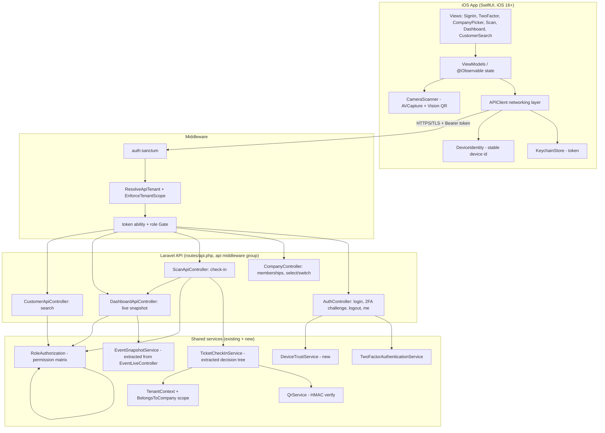
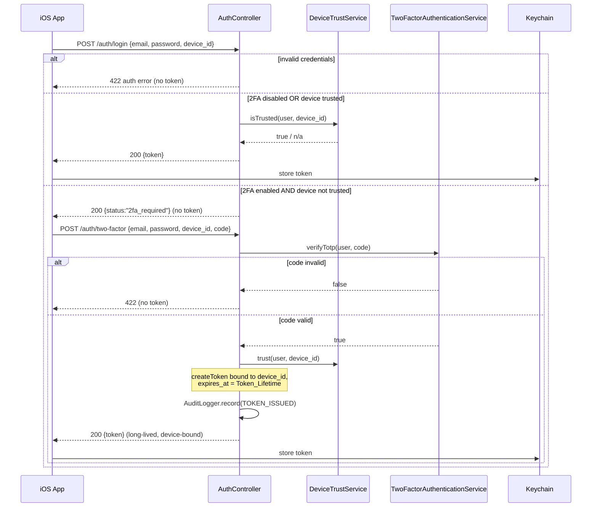
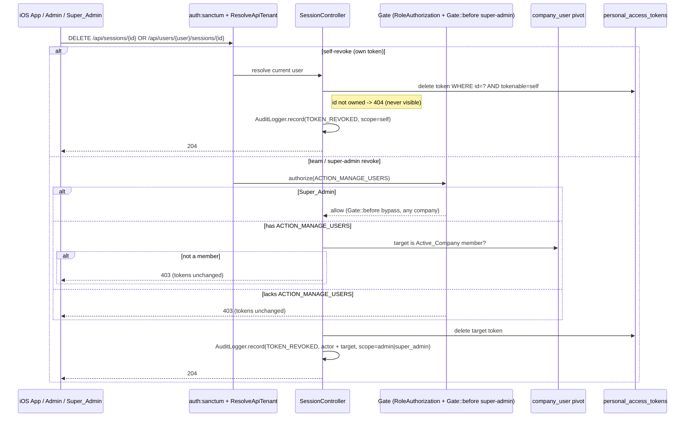

# Design Document

## Overview

This feature adds a JSON API to the existing Laravel platform and a native Swift/SwiftUI iOS client that together let event staff sign in, scan tickets, watch a live check-in dashboard for the active event, and search customers. The platform today serves only session-based web auth: there is no `routes/api.php`, no Sanctum, and `User` carries a single `company_id`.

The design makes one architectural promise above all others: **the scan decision tree is written once and shared.** The web scanner's `ScanController` already encodes the full Scan_Outcome decision tree (`resolve` → `checkIn` → `alreadyScanned`/`breakdown`). That logic is extracted into a `TicketCheckInService` that both the existing web controller and the new API call, so the two surfaces can never diverge on what "already scanned" or "rejected" means. Everything else — Sanctum auth, per-device TOTP trust, token-based tenant scoping, role-gated endpoints — is new plumbing wrapped around that shared core and around the services that already exist (`QrService`, `RoleAuthorization`, `EventLiveController`'s snapshot, `CustomerController`'s roster query).

The iOS app owns only what must live on the device: the camera, Vision QR decoding, Keychain token storage, a stable device identifier, and a manual-reference fallback. No verification happens on the device; every scan is a round trip to the API (Requirement 9).

**Satisfies:** the Introduction and the cross-cutting intent of Requirements 1–12.

### Key decisions grounded in the codebase

- **Reuse, don't reimplement.** `ScanController::resolve/checkIn/alreadyScanned/breakdown` is already pure of HTTP concerns and returns a structured array. We lift it verbatim into a service rather than re-deriving the decision tree. `QrService` already does HMAC verify with constant-time comparison; the API never touches the secret directly.
- **Membership is a new concept.** `User` has one `company_id`, and `ResolveDashboardTenant` binds exactly that company for the web. Requirement 4 ("one or more companies", a company picker, switching) needs a many-to-many. We add a `company_user` membership pivot and a `ResolveApiTenant` middleware that binds the Active_Company from the token — mirroring `ResolveDashboardTenant` but driven by the token's selected company rather than `user.company_id`. The web path is untouched.
- **Tenant scoping is already centralised.** `TenantContext` + the `BelongsToCompany` global scope confine every Company-owned query. The API reuses them unchanged: the new middleware just calls `TenantContext::setCompany()` with the token's company, so `Order`, `ScanEvent`, etc. scope automatically, exactly as the web dashboard does.
- **2FA is already a service.** `TwoFactorAuthenticationService::verifyTotp()` + `useRecoveryCode()` and `User::hasTwoFactorEnabled()` are reused as-is. The API adds only device-trust persistence and token issuance around them.

## Architecture

### Component overview



**Satisfies:** Requirements 1–12 (component responsibilities), 9.3 (no HMAC on device — `QrService` stays server-side), 12.3 (tenant scope on every data request).

### Request lifecycle for an authenticated API call

1. TLS terminates at the edge; `EnforceHttps` (new, API group) rejects any non-TLS request (Requirement 12.2).
2. `auth:sanctum` resolves the token → the `User`; a revoked/missing token yields 401 (Requirements 3.3, 12.5).
3. `ResolveApiTenant` reads the token's selected `company_id`, verifies the user is a member, binds it via `TenantContext::setCompany()`, and `EnforceTenantScope` clears it after the response. Any Company-owned query is now scoped (Requirements 4.1, 4.3, 12.3).
4. The controller authorises the action against `RoleAuthorization` (via the existing `Gate`) before touching data (Requirements 5.2, 7.5, 8.3).

### Middleware registration

`bootstrap/app.php` gains an `api` routing file and group. Because the existing file already configures middleware in the `withMiddleware` closure, we add:

```php
->withRouting(
    web: __DIR__.'/../routes/web.php',
    api: __DIR__.'/../routes/api.php',   // NEW
    commands: __DIR__.'/../routes/console.php',
    health: '/up',
)
```

```php
// inside withMiddleware(...)
$middleware->api(prepend: [
    \App\Http\Middleware\EnforceHttps::class,   // Requirement 12.2
]);

$middleware->group('api.tenant', [
    \App\Http\Middleware\EnforceTenantScope::class,   // reused unchanged
    \App\Http\Middleware\ResolveApiTenant::class,     // new, token-driven; also enforces device binding
]);
```

`ResolveApiTenant` runs after `auth:sanctum` and, in addition to binding the Active_Company, enforces the token's device binding (Requirements 13.3, 13.4): it compares the request's `X-Device-Id` header against the `device_id` stored on the resolving `personal_access_tokens` row and aborts 401 on mismatch before any Company query runs. Keeping the check here means every authenticated API route inherits device binding without per-controller code.

Sanctum is installed and configured first (it is not present today):

```
composer require laravel/sanctum
php artisan vendor:publish --tag=sanctum-config
php artisan migrate   # creates personal_access_tokens
```

`User` gains the `Laravel\Sanctum\HasApiTokens` trait.

**Token expiry (Requirement 13.1, 13.2).** Sanctum rejects expired tokens inside `auth:sanctum` exactly as it rejects missing/revoked ones, so expiry needs no new code — only configuration. We set the Token_Lifetime in `config/sanctum.php`:

```php
// config/sanctum.php — the configurable Token_Lifetime (minutes); null = never
'expiration' => (int) env('SANCTUM_TOKEN_EXPIRATION', 60 * 24 * 7), // e.g. 7 days
```

`'expiration'` is global; where a shorter per-token life is wanted (e.g. a password-only token issued before 2FA), the issuing call passes an explicit `expiresAt` to `createToken(...)`, which Sanctum stores in the `expires_at` column and honours over the global value. Either way an elapsed token is treated identically to a revoked one at `auth:sanctum` (Requirement 13.2).

**Named rate limiters (Requirement 15).** `RateLimiter::for(...)` declarations live in a service provider (`AppServiceProvider::boot` / the API bootstrap), mirroring how Laravel's default limiters are registered, and are attached as `throttle:{name}` middleware per route:

```php
RateLimiter::for('login', fn (Request $r) => [            // Requirement 15.3 (kept)
    Limit::perMinute((int) config('api.throttle.login'))->by($r->input('email').'|'.$r->ip()),
]);
RateLimiter::for('2fa', fn (Request $r) =>                // Requirement 15.1
    Limit::perMinute((int) config('api.throttle.2fa'))->by($r->input('email').'|'.$r->ip()));
RateLimiter::for('scan', fn (Request $r) =>              // Requirement 15.2 (per operator)
    Limit::perMinute((int) config('api.throttle.scan'))->by((string) $r->user()?->getKey()));
```

All three limits are configurable via `config/api.php` (env-backed), so door throughput and anti-guessing windows can be tuned per deployment without code changes.

**Satisfies:** Requirements 3.3, 4.1, 12.2, 12.5, 13.1–13.4, 15.1–15.3, and the Introduction's "add Sanctum + routes/api.php".

## Components and Interfaces

### Backend

#### `TicketCheckInService` (new — the shared decision tree)

The heart of the DRY refactor. `ScanController`'s private `resolve`, `checkIn`, `alreadyScanned`, and `breakdown` methods move here **unchanged in behaviour**; the operator identity (`scanned_by`, `operator_id`, `operator_name`) is passed in rather than read from `Auth` so both web and API callers supply their own authenticated user. `ScanEvent` recording also moves here so every caller records identically (Requirement 5.10, 7's feed source).

```php
final class TicketCheckInService
{
    public function __construct(private QrService $qr) {}

    /**
     * Resolve a scanned QR_Payload OR a manually typed Order_Reference to a
     * Scan_Outcome, performing the atomic single check-in when valid, and
     * recording a ScanEvent. Runs entirely under the active TenantContext,
     * so Orders of other Companies never match.
     */
    public function resolve(string $payload, Operator $operator): ScanResult;
}

/** The structured outcome — identical shape to the web controller's array. */
final class ScanResult
{
    public string $status;            // checked_in|already_scanned|rejected|failed|invalid|unreadable
    public string $message;
    public ?Order $order;
    public ?Carbon $scannedAt;
    public ?string $scannedByName;
    /** @var list<array{name:string, quantity:int}> */
    public array $breakdown;
}
```

`ScanController::scan` becomes a thin adapter: build an `Operator` from `Auth::user()`, call the service, keep its session-recap/HTML-fragment rendering. The API controller builds an `Operator` from the token's user and serialises `ScanResult` to JSON. The decision tree, the `UPDATE ... WHERE scanned_at IS NULL` atomic guard (Requirement 5.9), the tenant-scoped load (5.5), the confirmed check (5.6), and the manual-vs-QR separator split (6.1) all live in one place.

**Satisfies:** Requirements 5.3–5.10, 6.1, 6.2, and the Introduction's single-source-of-truth refactor goal.

#### `DeviceTrustService` (new)

Records and queries per-user device trust. A device id is a client-supplied opaque string (see iOS `DeviceIdentity`) sent as the `X-Device-Id` header and in the login/challenge bodies.

```php
final class DeviceTrustService
{
    public function isTrusted(User $user, string $deviceId): bool;
    public function trust(User $user, string $deviceId, ?string $name): TrustedDevice;
    public function forget(User $user, string $deviceId): void;
}
```

Trust is stored in a new `trusted_devices` table (see Data Models). A device is trusted only after a successful TOTP challenge (Requirement 2.1); subsequent logins from that `(user, device)` pair skip the challenge (Requirements 1.4, 2.4).

#### `AuthController`

```php
POST /api/auth/login          // email, password, device_id -> token | 2fa_required | 422
POST /api/auth/two-factor     // email, password, device_id, code|recovery_code -> token | 422
POST /api/auth/logout         // (auth) revokes current token
GET  /api/auth/me             // (auth) current user + permitted actions + memberships
```

`login` validates credentials with `Auth::validate()` (no session is created — the API is stateless/token-based). On success:
- If `!user->hasTwoFactorEnabled()` OR `DeviceTrustService::isTrusted(user, deviceId)` → issue a token immediately (Requirements 1.1, 1.4).
- Else respond `{ "status": "2fa_required" }` with **no token** (Requirement 1.3).

`two-factor` re-validates credentials, then `TwoFactorAuthenticationService::verifyTotp()` (or `useRecoveryCode()`). On success it trusts the device and issues a long-lived token (Requirements 2.1, 2.2); on failure it returns 422 and issues nothing (Requirement 2.3). Invalid credentials anywhere return a generic auth error and no token (Requirement 1.2). Failed login/2FA are audited via the existing `AuditLogger` actions already used by the web controllers.

Token abilities encode the user's permitted actions from `RoleAuthorization::permittedActions($user->role)` (e.g. `check_in`, `orders`) plus a `company:{id}` ability naming the selected Active_Company. Every `createToken(...)` call stores the issuing `device_id` on the token row and sets its expiry to the configured Token_Lifetime, binding the token to one Device and giving it a self-expiring life (Requirements 13.1, 13.3). On every successful issuance `AuthController` writes a `TOKEN_ISSUED` Audit_Entry; on every failed login or failed TOTP it writes `AUTH_LOGIN_FAILED` / `AUTH_MFA_CHALLENGE_FAILED` (Requirements 16.1, 16.4). `logout` calls `$request->user()->currentAccessToken()->delete()` and records a `TOKEN_REVOKED` entry scoped `logout` (Requirements 3.1, 3.3, 12.5, 16.2). The login and 2FA endpoints carry `throttle:login` and `throttle:2fa` respectively (Requirements 15.1, 15.3).

**Satisfies:** Requirements 1.1–1.4, 2.1–2.4, 3.1, 3.3, 13.1, 13.3, 15.1, 15.3, 16.1, 16.2, 16.4.

#### `CompanyController`

```php
GET  /api/companies            // (auth) list the user's memberships
POST /api/companies/{id}/select  // (auth) set Active_Company; rebuild token ability -> company:{id}
```

Memberships come from the `company_user` pivot. Selecting a company the user is **not** a member of returns 403 and leaves the Active_Company unchanged (Requirement 4.5). Selecting/switching re-mints the token's `company:{id}` ability (or updates a `current_company_id` column on the token's owning row — see Data Models) so every later request re-scopes (Requirements 4.3, 4.4). A single-membership user is handled client-side by auto-selecting without a picker (Requirement 4.6); the server still enforces membership. A successful select/switch records a `COMPANY_SELECTED` Audit_Entry naming the chosen Company (Requirement 16.3).

**Satisfies:** Requirements 4.2–4.6, 16.3.

#### `ScanApiController`

```php
POST /api/scan   // (auth, api.tenant, ability:check_in) { payload? , reference? } -> ScanResult JSON
```

Gated with `Gate::authorize(RoleAuthorization::ACTION_CHECK_IN)` exactly as the web scanner (Requirements 5.1, 5.2). Accepts either a scanned `payload` (QR_Payload) or a manual `reference`; both funnel through `TicketCheckInService::resolve`. The JSON mirrors the Scan_Outcome contract below.

**Satisfies:** Requirements 5.1–5.10, 6.1–6.2.

#### `DashboardApiController`

```php
GET /api/dashboard/live   // (auth, api.tenant, ability:check_in) -> live snapshot for Active_Event
```

The snapshot logic is extracted from `EventLiveController::snapshot()` into an `EventSnapshotService` so web and API share it; the API variant **omits** `sold`/revenue framing beyond counts and returns only attendance figures and recent `ScanEvent`s (Requirements 7.2, 7.3, 7.4). It is gated on `ACTION_CHECK_IN` (the API's dashboard is a door tool), not `ACTION_VIEW_REPORTS` as the web one is — this is the one deliberate authorisation difference, noted because the requirement names `ACTION_CHECK_IN` (Requirements 7.1, 7.5). The Active_Event is the Active_Company's most imminent/in-progress published, non-cancelled event (`starts_at` nearest now), resolved tenant-scoped.

**Satisfies:** Requirements 7.1–7.5.

#### `CustomerApiController`

```php
GET /api/customers?q=term  // (auth, api.tenant, ability:orders) -> paginated customer rows
```

Reuses `CustomerController::index`'s aggregate query (name/email search, order count, confirmed spend), gated on `ACTION_MANAGE_ORDERS` (Requirements 8.1, 8.2, 8.3). The query already runs under the tenant scope, so no cross-company rows leak (Requirement 12.3).

**Satisfies:** Requirements 8.1–8.3.

#### `SessionController` (new — session visibility and three-level revocation)

A **Session** is exactly one `personal_access_tokens` row: its `id`, its device label (`name`), and Sanctum's `last_used_at`. No new session store is introduced — Sanctum already is the session ledger. `SessionController` exposes viewing and revocation at three authority levels, each with a distinct authorization check performed **before** any delete so a denied request changes nothing (Requirements 14.4, 14.5).

```php
// Self level — a Staff_User's own Sessions
GET    /api/sessions            // (auth) list own tokens
DELETE /api/sessions/{id}       // (auth) revoke one own token

// Team level — another member's Sessions, gated on ACTION_MANAGE_USERS
GET    /api/users/{user}/sessions      // (auth, ability:users) list target's tokens
DELETE /api/users/{user}/sessions/{id} // (auth, ability:users) revoke target's token
```

**Request/response shapes.**

```jsonc
// GET /api/sessions  ->  200
{ "sessions": [
  { "id": 42, "device_label": "Alex's iPhone", "last_used_at": "2025-01-01T19:30:00+00:00",
    "created_at": "2025-01-01T08:00:00+00:00", "current": true } ] }

// DELETE /api/sessions/{id}  ->  204   (or 404 if the id is not one of the caller's own tokens)
// GET /api/users/{user}/sessions  ->  200  (same `sessions` shape for the target user)
// DELETE /api/users/{user}/sessions/{id}  ->  204
```

**Authorization per level.**

1. **Self** — `GET /api/sessions` and `DELETE /api/sessions/{id}` operate only on `$request->user()->tokens()`. A token id that does not belong to the caller resolves to 404 (it is never visible), so a Staff_User can only ever see and revoke their own Sessions (Requirements 14.1, 14.2). `current` marks the token the request itself authenticated with.

2. **Team** — the team routes carry `ability:users`, and the controller additionally re-checks `Gate::authorize(RoleAuthorization::ACTION_MANAGE_USERS)` (belt and braces, because abilities are minted at issue time). The target `{user}` MUST be a member of the **Active_Company**, verified against the `company_user` pivot (`companies()->whereKey(activeCompanyId)` for the target). A caller lacking `ACTION_MANAGE_USERS` → 403, tokens unchanged (Requirement 14.4); a target who is not an Active_Company member → 403, tokens unchanged (Requirement 14.5). Only when both hold does the controller delete the target token.

3. **Super_Admin** — a Super_Admin is not part of the Company matrix. The existing `Gate::before` hook in `AppServiceProvider::registerRoleGates()` returns `true` for `isSuperAdmin()`, so the same `Gate::authorize(ACTION_MANAGE_USERS)` call on the team routes passes for a Super_Admin **regardless of Company**, and the Active_Company membership check is skipped for a Super_Admin actor. This reuses the platform's single super-admin bypass rather than adding a parallel path, so a Super_Admin may revoke any Staff_User's tokens cross-company (Requirement 14.6).

Revocation at every level is `->delete()` on the `PersonalAccessToken` row, after which `auth:sanctum` rejects any later request bearing it (Requirement 14.7, consistent with Property 10). Each revocation and each listing that mutates nothing is recorded via `AuditLogger` (see Audit logging) capturing the acting actor and the target Staff_User.

**Satisfies:** Requirements 14.1–14.7.

#### Audit logging on the API (reusing `AuditLogger`)

The API records sensitive access events through the existing `AuditLogger::record(...)` service — the same one the web `LoginController`, `TwoFactorChallengeController`, and `TwoFactorController` already use. `record()` resolves the acting actor, the affected Company (from `TenantContext`, which `ResolveApiTenant` has already bound), the Super_Admin/impersonation stamp, and the request IP automatically, so API call sites pass only the action key, an optional subject, a short summary, and a **PII-minimised** `context` (ids/refs only). The existing `AUTH_LOGIN_FAILED` and `AUTH_MFA_CHALLENGE_FAILED` constants are reused verbatim so the API's failed sign-in / failed TOTP entries read identically to the web ones (Requirement 16.4).

**New action constants** added to `AuditLog` (and to the `ACTIONS` catalogue so the activity log groups/labels them), in the existing `subject.verb` past-tense style:

| Constant | Key | Category | Written when |
|---|---|---|---|
| `TOKEN_ISSUED` | `token.issued` | auth | A token is minted on sign-in or on Device trust (Requirement 16.1) |
| `TOKEN_REVOKED` | `token.revoked` | auth | A token is revoked by self, an `ACTION_MANAGE_USERS` actor, a Super_Admin, or logout (Requirement 16.2) |
| `COMPANY_SELECTED` | `company.selected` | access | The Active_Company is selected or switched (Requirement 16.3) |

Reused unchanged: `AUTH_LOGIN_FAILED`, `AUTH_MFA_CHALLENGE_FAILED` (Requirement 16.4).

**Call sites and context payloads** (every payload is ids/refs only — never a token value, password, TOTP code, recovery code, or the QR HMAC secret, honouring Requirement 16.5 and the `AuditLogger` PII-minimisation contract):

```php
// AuthController::login / two-factor — on token issue (Req 16.1)
$this->audit->record(
    action: AuditLog::TOKEN_ISSUED,
    auditable: $user,
    summary: 'Issued an API access token',
    context: ['token_id' => $accessToken->accessToken->getKey(),
              'device_id' => $deviceId, 'trusted' => $viaTrustedDevice],
);

// AuthController::logout + SessionController revocation (Req 16.2)
$this->audit->record(
    action: AuditLog::TOKEN_REVOKED,
    auditable: $targetUser,                 // the Staff_User whose Session was revoked
    summary: 'Revoked an API access token',
    context: ['token_id' => $tokenId,
              'revoked_by' => $actor->getKey(),       // acting actor
              'scope' => $scope],                      // self|admin|super_admin|logout
);

// CompanyController::select — on select/switch (Req 16.3)
$this->audit->record(
    action: AuditLog::COMPANY_SELECTED,
    summary: 'Selected the active company',
    context: ['company_id' => $company->getKey()],
    companyId: $company->getKey(),
);

// AuthController — failed login / failed TOTP (Req 16.4), reusing existing constants
$this->audit->record(action: AuditLog::AUTH_LOGIN_FAILED, auditable: $targetOrNull, summary: 'Failed API sign-in');
$this->audit->record(action: AuditLog::AUTH_MFA_CHALLENGE_FAILED, auditable: $user, summary: 'Failed API two-factor challenge');
```

Because `TOKEN_REVOKED` names both the acting actor (resolved automatically as `actor_user_id`, and echoed in `context.revoked_by` for self-vs-other clarity) and the target Staff_User (the `auditable`), self-revoke, admin revoke, Super_Admin revoke, and logout are all distinguishable in the trail while sharing one action key (Requirement 16.2). The `context` never carries the plaintext token — only its integer id — so a leaked audit log can never replay a Session (Requirement 16.5).

**Satisfies:** Requirements 16.1–16.5.

### iOS client

```
EventsScanner/
  App/            EventsScannerApp.swift, AppState (@Observable)
  Networking/     APIClient, APIError, Endpoints, DTOs (Codable)
  Auth/           AuthStore, KeychainStore, DeviceIdentity
  Features/
    SignIn/       SignInView + ViewModel
    TwoFactor/    TwoFactorView + ViewModel
    Company/      CompanyPickerView + ViewModel
    Scan/         ScanView, CameraScanner (AVCapture+Vision), ManualEntryView
    Dashboard/    DashboardView + ViewModel (polls /dashboard/live)
    Customers/    CustomerSearchView + ViewModel (role-gated)
  Common/         Reachability, Views
```

- **`APIClient`** sets `Authorization: Bearer <token>` and `X-Device-Id`, enforces HTTPS base URL, decodes DTOs, and maps non-2xx into `APIError` (offline, unauthorized, forbidden, serverMessage). On 401 it clears the Keychain token and routes to sign-in (Requirements 3.2, 3.3).
- **`KeychainStore`** persists only the Access_Token (`kSecClassGenericPassword`, device-only accessibility). The password is never stored (Requirements 12.1, 12.4).
- **`DeviceIdentity`** generates a UUID once, stores it in the Keychain, and returns it stably thereafter — the device id the API trusts (Requirements 2.1, 2.4). It is not `identifierForVendor` (which can reset on reinstall); a Keychain-backed UUID survives reinstalls so trust persists per the requirement's intent.
- **`CameraScanner`** requests camera permission (Requirement 10.1); on denial it shows "camera access is required" and does not scan (Requirement 10.2). While granted it runs an `AVCaptureSession` feeding frames to `VNDetectBarcodesRequest` (symbology `.qr`); a decoded payload is submitted to `/api/scan` (Requirements 10.3, 10.4). No HMAC/verification runs on device (Requirement 9.3).
- **`ManualEntryView`** is the always-available fallback that posts `reference` instead of `payload` (Requirements 6.3, 6.2).
- **Role visibility** is driven entirely by the server: `/api/auth/me` returns `permitted_actions`. The app shows Scan + Dashboard when `check_in` is present and shows Customer Search only when `orders` is present, hiding it otherwise (Requirements 8.4, 8.5).
- **Offline handling**: `Reachability` + a failed request surface an offline message and never report a successful check-in; scans are not queued (Requirements 9.1, 9.2).
- **Flow**: SignIn → (optional TwoFactor) → (CompanyPicker only when memberships > 1) → TabView(Scan, Dashboard, [Customer Search if permitted]) (Requirements 4.2, 4.6, 8.4, 8.5).
- **Platform/distribution**: deployment target iOS 16.0; distributed via App Store / TestFlight (Requirements 11.1, 11.2).

**Satisfies:** Requirements 3.2, 6.3, 8.4, 8.5, 9.1–9.3, 10.1–10.4, 11.1, 11.2, 12.1, 12.4.

## Sequence Diagrams

### Login + 2FA + token issuance



On every authenticated call thereafter, `auth:sanctum` rejects the token once `expires_at` has elapsed (Requirement 13.2), and `ResolveApiTenant` rejects it if the request's `X-Device-Id` does not match the token's bound `device_id` (Requirement 13.4) — both before any Company query runs.

### Session revocation (three levels)



**Satisfies:** Requirements 14.1–14.7, 16.2 (revocation diagram); 13.2, 13.4 (expiry/device-binding note).

### Scan to check-in

```mermaid
sequenceDiagram
    participant Cam as CameraScanner (Vision)
    participant App as iOS App
    participant MW as auth:sanctum + ResolveApiTenant + Gate
    participant Svc as TicketCheckInService
    participant QR as QrService
    participant DB as Orders / ScanEvents

    Cam->>App: decoded QR_Payload (or manual reference)
    App->>MW: POST /api/scan (Bearer token, X-Device-Id)
    MW->>MW: resolve user, bind Active_Company, authorize check_in
    alt not permitted
        MW-->>App: 403 (data unchanged)
    else permitted
        MW->>Svc: resolve(payload, operator)
        Svc->>QR: verifyPayload(payload)  %% skipped for manual reference
        alt undecodable
            Svc-->>App: {status:"unreadable"}
        else HMAC mismatch
            Svc-->>App: {status:"invalid"}
        else verified reference
            Svc->>DB: load Order (tenant-scoped)
            alt not found / foreign company
                Svc-->>App: {status:"rejected"}
            else not confirmed
                Svc-->>App: {status:"failed"}
            else already scanned
                Svc-->>App: {status:"already_scanned", scanned_at, operator}
            else atomic UPDATE ... WHERE scanned_at IS NULL
                Svc->>DB: 1 row -> checked_in; 0 rows -> already_scanned (winner)
                Svc->>DB: record ScanEvent
                Svc-->>App: {status:"checked_in", breakdown[]}
            end
        end
    end
```

**Satisfies:** Requirements 1.1–1.4, 2.1–2.4 (first diagram); 5.3–5.10, 6.1, 6.2 (second diagram).

## Data Models

### New: `trusted_devices`

Records a `(user, device)` pair that has passed a TOTP challenge, so later sign-ins from that device skip it (Requirements 2.1, 2.4). Not Company-owned (trust is per user, independent of Active_Company).

| Column | Type | Notes |
|---|---|---|
| id | bigint pk | |
| user_id | bigint fk → users, cascade on delete | |
| device_id | string (indexed) | client-supplied opaque id |
| name | string null | optional device label |
| trusted_at | timestamp | |
| last_used_at | timestamp null | |
| timestamps | | |

Unique index on `(user_id, device_id)`.

### New: `company_user` membership pivot

Requirement 4 needs a user to belong to one or more companies. `User.company_id` stays (the web dashboard still uses it as the user's home company and `ResolveDashboardTenant` is untouched). The pivot adds additional memberships and the role held per company.

| Column | Type | Notes |
|---|---|---|
| id | bigint pk | |
| company_id | bigint fk → companies, cascade | |
| user_id | bigint fk → users, cascade | |
| role | string | one of `User::ROLES`, per-company role |
| timestamps | | |

Unique index on `(company_id, user_id)`. `User` gains `companies(): BelongsToMany`. A data backfill seeds one membership row from each existing `(user.company_id, user.role)` so current users keep working. For the API, the token's Active_Company resolves the role from this pivot, which `RoleAuthorization` then evaluates.

### Reused + extended: `personal_access_tokens` (Sanctum)

Created by Sanctum's migration, which already ships the columns the Session concept needs: `name` (used as the human **device label**), `abilities`, `last_used_at` (Sanctum updates it on every authenticated request — no extra tracking required, Requirement 14.1), and `expires_at` (the per-token expiry Sanctum enforces in `auth:sanctum`, Requirements 13.1, 13.2). A follow-up migration adds the columns this feature needs:

| Column | Type | Notes |
|---|---|---|
| device_id | string, indexed | the Device the token is bound to; set at issuance, compared against `X-Device-Id` by `ResolveApiTenant` (Requirements 13.3, 13.4) |
| current_company_id | bigint null, fk → companies | the token's Active_Company; `CompanyController::select` updates it and re-mints abilities (Requirements 4.3, 4.4) |

`name` is populated from the login/challenge body's device label (falling back to a generic label) and surfaced as `device_label` in the Sessions API. `expires_at` is written by Sanctum from the global `config/sanctum.php` `'expiration'` (the configurable Token_Lifetime) or from an explicit per-token `expiresAt` passed to `createToken(...)`; nothing stores the plaintext token — only Sanctum's SHA-256 `token` hash — so an audit or Session listing never exposes a usable credential (Requirement 16.5). Device binding could alternatively be encoded as a `device:{id}` ability, but a first-class indexed column keeps the `ResolveApiTenant` comparison a simple equality check and supports team/admin listings by device.

### Reused unchanged

- **`users`** — `two_factor_secret`, `two_factor_confirmed_at`, `password` (hashed), `role`. `HasApiTokens` trait added.
- **`orders`** — `order_reference`, `status`, `scanned_at`, `scanned_by`, `company_id`. The atomic check-in writes `scanned_at`/`scanned_by`.
- **`scan_events`** — the breadcrumb the dashboard feed reads; written by `TicketCheckInService` (Requirement 5.10).
- **`companies`** — tenant root.

**Satisfies:** Requirements 2.1, 2.4, 4.2–4.6, 5.10.

## API Endpoints

| Method | Path | Auth / Gate | Request | Success | Requirements |
|---|---|---|---|---|---|
| POST | /api/auth/login | public, throttle:login | `email, password, device_id` | `{token}` or `{status:"2fa_required"}` | 1.1–1.4, 15.3 |
| POST | /api/auth/two-factor | public, throttle:2fa | `email, password, device_id, code` or `recovery_code` | `{token}` | 2.1–2.4, 15.1 |
| POST | /api/auth/logout | auth:sanctum | — | `204` | 3.1, 3.3, 16.2 |
| GET | /api/auth/me | auth:sanctum, api.tenant | — | `{user, permitted_actions[], companies[]}` | 8.4, 8.5 |
| GET | /api/companies | auth:sanctum | — | `[{id, name, role}]` | 4.2 |
| POST | /api/companies/{id}/select | auth:sanctum | — | `{active_company}` or `403` | 4.3–4.6, 16.3 |
| GET | /api/sessions | auth:sanctum | — | `{sessions[]}` (own) | 14.1 |
| DELETE | /api/sessions/{id} | auth:sanctum | — | `204` or `404` | 14.2, 14.7 |
| GET | /api/users/{user}/sessions | auth:sanctum, api.tenant, ability:users | — | `{sessions[]}` or `403` | 14.3–14.6 |
| DELETE | /api/users/{user}/sessions/{id} | auth:sanctum, api.tenant, ability:users | — | `204` or `403` | 14.3–14.7, 16.2 |
| POST | /api/scan | auth:sanctum, api.tenant, ability:check_in, throttle:scan | `payload` or `reference` | `ScanResult` | 5.1–5.10, 6.1, 6.2, 15.2 |
| GET | /api/dashboard/live | auth:sanctum, api.tenant, ability:check_in | — | snapshot | 7.1–7.5 |
| GET | /api/customers | auth:sanctum, api.tenant, ability:orders | `q` | paginated rows | 8.1–8.3 |

Every `auth:sanctum, api.tenant` route additionally inherits **device binding**: `ResolveApiTenant` rejects the request 401 if the `X-Device-Id` header does not match the token's bound `device_id` (Requirement 13.4). The `throttle:login`, `throttle:2fa`, and `throttle:scan` limiters are the configurable named limiters declared in Middleware registration (Requirements 15.1–15.3). The team-level session routes sit behind `api.tenant` so the Active_Company is bound for the membership check (Requirement 14.5) and for audit `company_id` resolution.

### Scan_Outcome contract

`POST /api/scan` returns one of six statuses with status-specific fields. HTTP status is `200` for every resolved outcome (the outcome is the payload), `403` only when the role lacks `check_in`, `401` for a bad token.

```jsonc
// checked_in
{ "status": "checked_in", "message": "Checked in.",
  "reference": "ABC123DEF456", "customer": "Sam Lee",
  "scanned_at": "2025-01-01T19:30:00+00:00",
  "breakdown": [ { "name": "General", "quantity": 2 } ] }

// already_scanned  (carries original scanned_at + operator, incl. concurrent-loser case)
{ "status": "already_scanned", "message": "Already scanned.",
  "reference": "ABC123DEF456", "customer": "Sam Lee",
  "scanned_at": "2025-01-01T19:10:00+00:00", "scanned_by": "Alex Door" }

// rejected  (no Order within tenant scope — foreign company or no match)
{ "status": "rejected", "message": "Ticket not found." }

// failed  (resolved Order not confirmed: voided/refunded/reserved/...)
{ "status": "failed", "message": "Failed. This ticket is no longer valid." }

// invalid  (decoded but HMAC mismatch)
{ "status": "invalid", "message": "Invalid code. This ticket could not be verified." }

// unreadable  (undecodable payload, or empty manual reference)
{ "status": "unreadable", "message": "Unreadable code. Please try scanning again." }
```

These map one-to-one onto `TicketCheckInService`'s statuses and onto `ScanEvent` outcomes (`success`/`duplicate`/`rejected`/`failed`/`unreadable`/`invalid`), so the web and API record identically (Requirement 5.10).

**Satisfies:** Requirements 5.3–5.10, 6.1, 6.2.

### Live snapshot shape

```jsonc
{
  "event": { "id": 12, "name": "Summer Fest", "starts_at": "..." },
  "stats": { "scanned": 240, "sold": 500, "remaining": 260, "rate": 48.0 },
  "recent": [ { "outcome": "success", "operator": "Alex", "reference": "...",
               "customer": "Sam Lee", "tickets": 2, "at": "..." } ]
}
```

No sales/revenue figures; Active_Event only (Requirements 7.2, 7.3, 7.4).

## Error Handling

- **Authentication (401):** missing/revoked/**expired**/invalid token → `401 {message}`. Sanctum handles missing/revoked/expired uniformly inside `auth:sanctum`, so an elapsed Token_Lifetime is rejected exactly like a revoked token (Requirements 3.3, 12.5, 13.2). `shouldRenderJsonWhen($request->is('api/*'))` already in `bootstrap/app.php` guarantees a JSON body.
- **Device mismatch (401):** a token whose bound `device_id` does not match the request's `X-Device-Id` → `401`, no data changed; `ResolveApiTenant` aborts before any handler or query runs (Requirement 13.4).
- **Authorization (403):** role lacks `check_in`/`orders` → `403`, **no data changed** (Gate runs before any mutation) (Requirements 5.2, 7.5, 8.3).
- **Membership (403):** selecting a non-member company → `403`, Active_Company unchanged (Requirement 4.5).
- **Validation (422):** bad login/2FA/missing fields → `422` with a generic auth message (never distinguishing "no such email" from "wrong password") (Requirements 1.2, 2.3).
- **Non-TLS (426/403):** `EnforceHttps` rejects before any handler runs (Requirement 12.2).
- **Rate limiting (429):** `throttle:login`/`throttle:2fa` (keyed per email+IP) and `throttle:scan` (keyed per authenticated operator) return `429` with `Retry-After` once the configured window limit is exceeded, until the window resets (Requirements 15.1–15.3).
- **Scan outcomes are not errors:** `unreadable`/`invalid`/`rejected`/`failed`/`already_scanned` are `200` payloads, not HTTP errors — the door operator always gets a structured result (Requirements 5.3–5.9).
- **iOS:** `APIError.offline` → "You're offline. Reconnect to scan." and no success reported (Requirements 9.1, 9.2); `.unauthorized` → clear Keychain, return to sign-in (Requirement 3.2); `.forbidden` → hide the feature / show "not permitted"; `.serverMessage` → surface the API message.

## Security

| Control | Mechanism | Requirements |
|---|---|---|
| TLS required | `EnforceHttps` middleware on the API group rejects non-TLS | 12.2 |
| Token in transit only | Bearer token over HTTPS; stored only in the iOS Keychain | 12.1 |
| No password persistence | iOS keeps the password in memory for the request only | 12.4 |
| No HMAC on device | `QrService` verify runs server-side; the device only decodes the QR image | 9.3 |
| Token abilities / scopes | Sanctum abilities carry `permitted_actions` + `company:{id}`; endpoints check both | 5.1, 5.2, 8.1 |
| Tenant isolation | `ResolveApiTenant` + `TenantContext` + `BelongsToCompany` scope every query | 4.1, 12.3 |
| Revocation | `logout` deletes the current token; `auth:sanctum` rejects it thereafter | 3.1, 3.3, 12.5 |
| Token expiry | Configurable Token_Lifetime via `config/sanctum.php` `'expiration'` / per-token `expires_at`; expired tokens rejected by `auth:sanctum` like revoked ones | 13.1, 13.2 |
| Device binding | Issuing `device_id` stored on the token; `ResolveApiTenant` rejects an `X-Device-Id` mismatch 401 with no data change | 13.3, 13.4 |
| Three-level revocation | Self (own tokens only); `ACTION_MANAGE_USERS` confined to Active_Company members; Super_Admin cross-company via the `Gate::before` bypass | 14.2–14.7 |
| Rate limiting | Named `login`/`2fa` (per email + IP) and `scan` (per operator) limiters, all configurable | 1.2, 2.3, 15.1, 15.2, 15.3 |
| Device trust gated on TOTP | A device is trusted only after a verified challenge | 2.1 |
| Audit logging | `AuditLogger` records token issuance/revocation (actor + target), company selection, and failed login/2FA; context is ids/refs only — never tokens, passwords, TOTP codes, or the HMAC secret | 16.1–16.5 |

## Correctness Properties

*A property is a characteristic or behavior that should hold true across all valid executions of a system — a formal statement about what the system should do. Properties bridge human-readable specifications and machine-verifiable correctness guarantees.*

### Property 1: QR payload resolves to the correct Scan_Outcome

For any string submitted to the check-in service under a resolved Active_Company, the returned Scan_Outcome is exactly: `unreadable` when the payload is undecodable or the manual reference is empty; `invalid` when it decodes but the recomputed HMAC does not match; `rejected` when the resolved reference matches no Order in the tenant scope; `failed` when the Order is not confirmed; `already_scanned` when the Order already has a `scanned_at`; and `checked_in` otherwise.

**Validates: Requirements 5.3, 5.4, 5.5, 5.6, 5.7, 5.8, 6.2**

### Property 2: Check-in is atomic under concurrency

For any confirmed, unscanned Order, when two or more check-in attempts target it, exactly one returns `checked_in` and every other returns `already_scanned` carrying the winner's `scanned_at`.

**Validates: Requirements 5.8, 5.9**

### Property 3: Manual reference and scanned payload are equivalent

For any confirmed, unscanned Order, submitting its Order_Reference manually (in any letter case) and submitting its QR_Payload both produce a `checked_in` outcome with the same ticket-type breakdown.

**Validates: Requirements 6.1, 5.8**

### Property 4: Every resolved check-in records exactly one Scan_Event

For any check-in request that the service resolves, exactly one `scan_events` row is written under the Active_Company capturing the mapped outcome, the operator, and the Order_Reference.

**Validates: Requirements 5.10**

### Property 5: Tenant scope confines every API response

For any authenticated API request with Active_Company C, no scan, dashboard, or customer-search response includes a record belonging to a company other than C.

**Validates: Requirements 4.1, 12.3, 7.4**

### Property 6: Role gating is total and side-effect-free on denial

For any authenticated user and any gated endpoint, the request is accepted if and only if the user's role (for the Active_Company) holds the required action in `RoleAuthorization`; a denied request changes no data.

**Validates: Requirements 5.1, 5.2, 7.1, 7.5, 8.1, 8.3**

### Property 7: A token is issued only when authentication fully succeeds

For any login attempt, an Access_Token is issued if and only if the credentials are valid AND (two-factor is disabled OR the device is already trusted OR a valid TOTP/recovery code is supplied in the challenge); in every other case no token is issued.

**Validates: Requirements 1.1, 1.2, 1.3, 1.4, 2.2, 2.3**

### Property 8: Device trust is established only by a passed challenge and then persists

For any user with two-factor enabled and any device, the device becomes trusted only after a successful TOTP challenge, and once trusted, subsequent logins from that device for that user skip the challenge.

**Validates: Requirements 2.1, 2.4, 1.4**

### Property 9: Company selection respects membership

For any user and any company id, selecting that company sets it as the Active_Company if the user is a member and otherwise is rejected with the Active_Company left unchanged.

**Validates: Requirements 4.3, 4.4, 4.5**

### Property 10: Revoked tokens are universally rejected

For any Access_Token that has been revoked, every subsequent request presenting it is rejected with an authentication error.

**Validates: Requirements 3.1, 3.3, 12.5**

### Property 11: Expired or wrong-device tokens are rejected without side effects

For any Access_Token issued to a device, the token carries a stored device identifier equal to the issuing device and an expiry equal to the configured Token_Lifetime; and for any authenticated request presenting that token, if the Token_Lifetime has elapsed OR the request's supplied device identifier does not equal the token's bound device identifier, the API rejects the request with an authentication error (401) in the same manner as a revoked token and leaves all data unchanged.

**Validates: Requirements 13.1, 13.2, 13.3, 13.4**

### Property 12: Token revocation authority is confined to the right level

For any actor and any target Staff_User, a revocation request succeeds if and only if one of the following holds: the actor is revoking one of their own Sessions; the actor holds ACTION_MANAGE_USERS and the target is a member of the Active_Company; or the actor is a Super_Admin (any Company). In every other case — an actor without ACTION_MANAGE_USERS targeting another user, or an ACTION_MANAGE_USERS actor targeting a non-member of the Active_Company — the API rejects the request with an authorization error (403) and leaves all Access_Tokens unchanged; and whenever a revocation succeeds, every subsequent request presenting the revoked token is rejected.

**Validates: Requirements 14.2, 14.3, 14.4, 14.5, 14.6, 14.7**

### Property 13: Sensitive access events are audited without recording secrets

For any sensitive API access event — token issuance on sign-in or device trust, token revocation (self, ACTION_MANAGE_USERS actor, Super_Admin, or logout), Active_Company selection or switch, and failed sign-in or failed TOTP challenge — the AuditLogger writes exactly one Audit_Entry recording the action, the acting actor, and (where applicable) the affected Company and target Staff_User; and no Audit_Entry it writes for the API contains a password, an Access_Token value, a TOTP code, or the QR HMAC secret in its summary or context.

**Validates: Requirements 16.1, 16.2, 16.3, 16.4, 16.5**

## Testing Strategy

### Backend (PHPUnit feature tests, `tests/Feature`)

Mirror the existing `ScanCheckInTest` conventions (`RefreshDatabase`, factories, real HTTP through the router).

- **Every Scan_Outcome** via `POST /api/scan`: `checked_in` (+ breakdown), `already_scanned` (+ scanned_at/operator), `rejected` (foreign-company and no-match), `failed` (voided/unconfirmed), `invalid` (HMAC mismatch), `unreadable` (garbage payload and empty manual reference). One test per outcome (Property 1).
- **Atomic concurrency**: two check-ins on one Order → exactly one `checked_in`, one `already_scanned` (Property 2) — a PBT-style test driving many Orders.
- **Manual ↔ scan equivalence** across generated references/cases (Property 3).
- **ScanEvent recording**: one row per resolved request, correct outcome mapping (Property 4).
- **Tenant isolation**: a token scoped to company A cannot scan/search/see company B's records (Property 5).
- **Role gating**: a Scanner is denied `/api/customers` (403); an Accountant (no `check_in`) is denied `/api/scan` and `/api/dashboard/live`; denial changes no data (Property 6).
- **Auth paths**: valid login no-2FA → token; invalid creds → 422 no token; 2FA-enabled untrusted device → `2fa_required` no token; valid TOTP → token + device trusted; invalid TOTP → 422 no token; trusted device skips challenge (Properties 7, 8).
- **Company select/switch**: member → sets Active_Company and re-scopes; non-member → 403 unchanged (Property 9).
- **Revocation**: logout then re-use token → 401 (Property 10).
- **Token expiry + device binding**: issue a token, assert `expires_at`/`device_id` are set; travel past expiry → 401; send a request with a mismatched `X-Device-Id` → 401 with no scan/session mutation (Property 11) — a PBT-style test over generated devices/payloads.
- **Three-level revocation authority**: self revokes own (and a foreign id → 404); an `ACTION_MANAGE_USERS` Owner/Admin revokes a same-company member but gets 403 on a non-member; an Accountant/Scanner (no `users`) gets 403 targeting another user; a Super_Admin revokes cross-company; denials leave tokens unchanged, and a successful revoke then 401s on reuse (Property 12).
- **Audit without secrets**: assert one `TOKEN_ISSUED`/`TOKEN_REVOKED`/`COMPANY_SELECTED`/`AUTH_LOGIN_FAILED`/`AUTH_MFA_CHALLENGE_FAILED` row per event with the right actor/company/target, and that no recorded `summary`/`context` contains the plaintext token, password, TOTP code, or HMAC secret (Property 13).
- **Rate limiting** (example tests, not PBT — count-based middleware): exceeding `throttle:2fa` → 429 then recovery after the window; exceeding `throttle:scan` as operator A → 429 for A while operator B stays 200 (per-operator key); `throttle:login` still applies (Requirements 15.1–15.3).
- **TLS**: non-TLS request rejected (Requirement 12.2).

Property tests use ≥100 iterations and are tagged `Feature: ios-scanner-app, Property {n}: {text}`.

### iOS (XCTest, where practical)

- **DTO decoding**: round-trip each Scan_Outcome JSON → model, asserting status mapping (supports Property 1 on the client).
- **KeychainStore**: store/read/delete token; token absent after logout (Requirements 3.2, 12.1).
- **DeviceIdentity**: stable across calls/reinstall simulation (Requirements 2.1, 2.4).
- **Role visibility**: given `permitted_actions`, the tab set shows/hides Customer Search correctly (Requirements 8.4, 8.5) — pure view-model logic.
- **Offline mapping**: a network failure maps to `.offline` and reports no success (Requirements 9.1, 9.2).
- **APIClient 401 handling**: clears token and routes to sign-in (Requirement 3.2).

Camera/Vision decoding and live camera permission are verified by manual/device testing (not unit-testable without hardware); the networking and state layers above are the practical XCTest surface.
